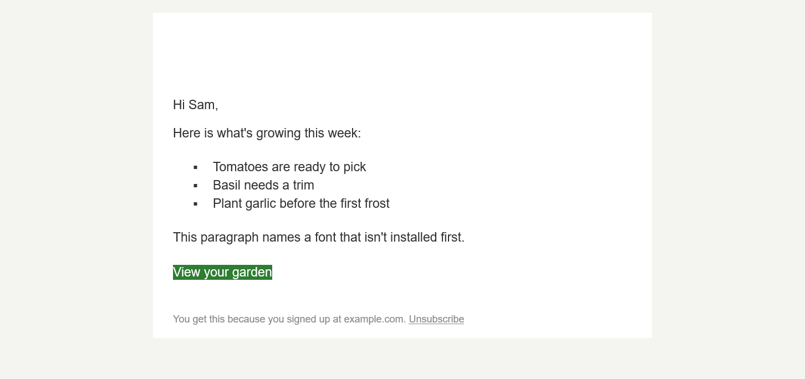

# msoshot

A small Windows tray app that opens an email in **classic Outlook**, screenshots it and sends back a PNG over HTTP. You can check how an email change looks in Outlook in seconds, without sending anything.

```sh
curl -X POST 'http://my-laptop:8787/render?subject=Test' \
  -H "Authorization: Bearer $TOKEN" \
  -H "Content-Type: text/html" \
  --data-binary @email.html -o outlook.png
```

> **An experiment, with no support.** This was vibe-coded, written mostly by an AI coding assistant, to scratch one itch. It works on the author's machine: classic Outlook (Microsoft 365, version 16) on Windows 11 at 150% scaling. Nothing else has been tried. There's no support and no promise of fixes or updates. Use it at your own risk; issues and pull requests may or may not get a reply.

## Why

The name comes from `mso`, which is what email developers call Outlook's Word-based engine (as in `<!--[if mso]>`), plus "shot" for screenshot.

Classic Outlook for Windows draws HTML email with Microsoft Word's layout engine. Browser previews and webmail don't show its quirks. For example:

- `<ul>` and `list-style` are ignored.
- `rgba()` colours are ignored.
- Padding on `<a>` is ignored, so link "buttons" collapse.
- Borders on `<tr>` are not drawn.
- Fonts are not inherited into nested tables.
- If the first font in a font stack isn't installed, the whole stack is ignored and the text falls back to Times New Roman.
- Widths come from `width=` attributes and `<!--[if mso]>` tables.

Here is the built-in sample newsletter as classic Outlook draws it. The coloured header band is gone, and the "View your garden" button has lost its padding:



Hosted services such as Litmus and Email on Acid solve this by running real clients on virtual machines. This tool does the same for one client, on a Windows machine you already have. It works because classic Outlook can open a `.eml` file directly with the same engine, so nothing needs to be delivered.

The "new Outlook" for Windows renders like a browser and has no automation interface. It isn't supported, and it wouldn't show these problems anyway.

## How it works

1. The email arrives on `POST /render`. If it's HTML, it's first wrapped in a minimal message.
2. The app writes the message to a temp `.eml` and opens it through Outlook's COM interface with `Session.OpenSharedItem`. If that fails, it falls back to `outlook.exe /eml`.
3. It sizes the message window, waits for it to settle and captures it. It uses `PrintWindow`, falling back to a screen copy if that comes back black. By default it crops to the message body.
4. It closes the window **without saving** and returns the PNG, with facts about the capture as headers.

Renders run one at a time; others queue. The app only opens and displays messages. It never sends, saves or moves mail, and it never quits Outlook.

## Requirements

- Windows 10 or 11 with **classic Outlook** (Microsoft 365, or Office 2016 or later) and a mail profile set up. You need your own Outlook licence. This project contains no Microsoft code.
- WebView2 for the dashboard window. Windows 11 includes it. `--headless` works without it.
- **Run it from your logged-in desktop** (it's a tray app), not as a Windows service and not over SSH. Outside the desktop session, Outlook windows can't be found and screenshots come out blank.
- **The same elevation as Outlook.** If Outlook runs normally (not as administrator), so must this app.

## Install

Download `msoshot-windows-amd64.exe` (or `-arm64.exe` for ARM laptops) from [Releases](https://github.com/jcsrb/msoshot/releases) and run it. It's unsigned, so SmartScreen may warn on first run ("More info" → "Run anyway"). `SHA256SUMS.txt` lists the checksums.

Or build it yourself on any OS with Go 1.26 or later. No C compiler is needed:

```sh
./build.sh      # writes bin/msoshot-windows-amd64.exe and -arm64.exe
```

`build.sh` embeds a manifest, the icon and version info using [go-winres](https://github.com/tc-hib/go-winres), which `go run` downloads on first use. `NO_RESOURCES=1 ./build.sh` skips that step: the exe still works, but has no icon.

Then:

1. **Check first.** In a terminal, run `msoshot.exe --check`. It prints what the app sees: whether classic Outlook is installed and reachable, the display scale, and whether this is a desktop session.
2. **Try one render without the network:**
   ```
   msoshot.exe --render-file email.html out.png
   ```
3. **Start the app normally.** A tray icon and the dashboard appear. On first run it creates a random token and listens on `127.0.0.1:8787`, which is reachable from this machine only.

## The dashboard

Click the tray icon to open it. It shows:

- **Outlook:** installed and reachable, version, display scale, desktop session, admin.
- **Server:** the listening address and token, buttons to copy or replace the token, and an address picker.
- **Try it:** renders a built-in sample email, and shows a ready-to-copy curl command.
- **Recent renders:** time, client, subject, result, duration and a thumbnail. Click a thumbnail for the full image.
- **Start at login:** a checkbox, also in the tray menu.

The dashboard runs inside the app window only. It isn't served on the network port.

## Reaching it from another machine

Pick the machine's address in **Listen on** and click **Apply**. Use an address on a private network, such as your home LAN or a VPN like Tailscale or WireGuard. Don't expose it to the internet: anything sent to it opens in your real Outlook profile.

If the address isn't available yet when the app starts (a VPN still connecting at login, say), the app keeps retrying.

Windows Firewall will ask the first time. VPN adapters are often treated as public networks, so you may need a rule. For example, this allows only Tailscale's address range (run once, as administrator):

```powershell
New-NetFirewallRule -DisplayName "msoshot" -Direction Inbound -Protocol TCP -LocalPort 8787 -RemoteAddress 100.64.0.0/10 -Action Allow
```

Settings live in `%AppData%\msoshot\config.json` and the log in `%LocalAppData%\msoshot\`. The log holds metadata only, never email content, subjects or the token.

## API

All requests need `Authorization: Bearer <token>`.

### `POST /render`

The body is one of:

| `Content-Type`   | Body |
|------------------|------|
| `text/html`      | An HTML document. It's wrapped in a message with subject `?subject=`, or the `X-Subject` header. A `charset=` parameter is respected (default UTF-8). |
| `message/rfc822` | A complete `.eml`, used as is. |

Query options:

| Option   | Default | Meaning |
|----------|---------|---------|
| `wait`   | `1500`  | Milliseconds to wait after the window opens before capturing (0–30000). |
| `width`  | `1000`  | Window width in logical pixels (multiplied by the display scale). |
| `height` | `900`   | Window height in logical pixels. The window is kept within the screen. |
| `crop`   | `body`  | `body` captures the message body only. `window` captures the whole Outlook window. |
| `pages`  | `1`     | Scroll and capture up to N screens, stacked into one PNG with a grey rule between them. Stops early at the end of the message. |
| `full`   | off     | `full=1` is shorthand for `pages=10`. |

The response is `200`, `image/png`, plus headers such as:

```
X-Render-Dpi: 144
X-Render-Scale: 1.50
X-Render-Outlook-Version: 16.0.0.19127
X-Render-Open-Method: OpenSharedItem
X-Render-Capture-Method: printwindow
X-Render-Crop: body
X-Render-Pages: 2
X-Render-Window-Width: 1500
```

Screenshots are in physical pixels. At 150% display scaling, a 600px email is about 900px wide in the image, matching what you see on that screen. Divide by `X-Render-Scale` to get CSS pixels.

Errors come back as JSON `{"error": "..."}`:

| Status | Meaning |
|--------|---------|
| 400 | Bad input |
| 401 | Missing or wrong token |
| 413 | Body too large (default limit 10 MB) |
| 503 | Outlook isn't reachable |
| 504 | The render timed out (often an Outlook dialog waiting for input) |
| 500 | Anything else |

### `GET /health`

Returns JSON with the following:

- whether classic Outlook is installed, running and reachable, and its version
- the display DPI and scale
- whether this is a desktop session, and whether the app runs as admin
- the listening address
- whether a render is in progress

## Client example

`examples/render.sh` posts an HTML or `.eml` file and saves the PNG:

```sh
export MSOSHOT_URL=http://my-laptop:8787 MSOSHOT_TOKEN=...
examples/render.sh internal/samples/sample.html outlook.png "Weekly update" "pages=2"
```

`internal/samples/sample.html` is a made-up newsletter that deliberately uses several constructs Outlook gets wrong.

## Develop

Everything except the Outlook automation runs on macOS (and on Linux with Wails' GTK4/WebKitGTK development packages installed):

```sh
go test ./...
go run . --fake          # the real tray app and dashboard, with a fake renderer
GOOS=windows go vet ./...
```

| Path | What it does |
|------|--------------|
| `internal/api` | The network API: auth, `/render`, `/health` |
| `internal/outlook` | Windows only: Outlook COM on a dedicated thread, window lookup, capture |
| `internal/dashboard` | The dashboard page and its local endpoints |
| `internal/ui` | Tray and window (Wails v3) |
| `internal/render`, `internal/eml` | Options, image helpers, `.eml` wrapping |
| `internal/listener`, `internal/config` | Address handling, retries, settings |

CI runs the tests on macOS and Windows. Pushing a `v*` tag builds both exes and creates a draft release.

## Notes and limits

- **Remote images** are blocked by Outlook's default privacy setting, so they render as placeholders. Images embedded in the `.eml` (`cid:`) display.
- **A window pops up during a render.** An Outlook window appears for a second or two. If capturing in the background returns a black image, the app brings the window to the front and copies the screen.
- **Very tall images** (`full=1`) get scaled down by most viewers and by AI models reading screenshots. A small `pages` value, such as 2 or 3, is usually more useful.
- **Scrolled pages** are stitched by finding the rows that repeat between screens and dropping them. `X-Render-Overlap-Rows` reports how many rows were removed at each seam; a `0` means no overlap was found there.

## Licence

[MIT](LICENSE). Not affiliated with Microsoft. Outlook is a trademark of Microsoft Corporation.
